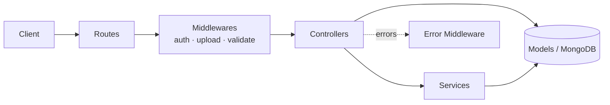
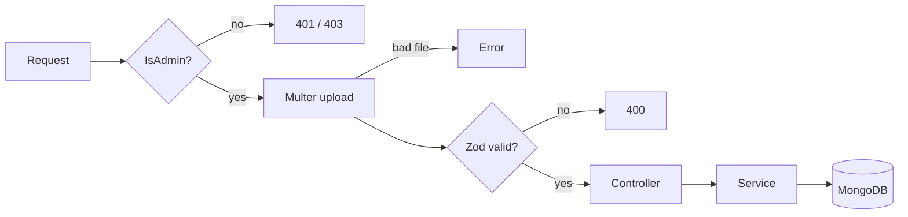

# 🛒 E-Commerce API — Node.js · TypeScript · MongoDB

A RESTful e-commerce back-end built with **Express, TypeScript and Mongoose**, designed around a small set of well-known **design patterns** so that adding a new resource takes a few lines instead of a few hundred.


---

## ✨ Features

- 🔐 **JWT authentication** with role-based access (`admin` / `user`)
- 📦 Full **CRUD** for users, products, categories, subcategories and orders
- 🔎 **Advanced querying** on every list endpoint: filtering, sorting, field selection, pagination
- 🖼️ **Image upload** for products (Multer: type filter, 5 MB limit, up to 5 images)
- ✅ **Schema-based request validation** with Zod (body, query and params)
- 🛡️ Security middleware (Helmet, CORS) and bcrypt password hashing
- 🌱 **Seed scripts** using Faker (up to 30,000 products) for realistic load testing
- 🧱 Centralized error handling

---

## 🧠 The Power of Patterns

The main idea of this project: **write the behavior once, reuse it everywhere.** These are the patterns used and what each one buys you.

### 1. Layered Architecture — separation of concerns



| Layer | Folder | Responsibility |
|---|---|---|
| Routes | `src/routes` | Map URL + HTTP verb to a chain of handlers |
| Middlewares | `src/middlewares` | Cross-cutting concerns: auth, validation, uploads, errors |
| Controllers | `src/controllers` | Translate HTTP ⇄ application calls |
| Services | `src/services` | Business logic (registration, login, product creation) |
| Models | `src/models` | Mongoose schemas and data-level rules |
| Validation | `src/validation` | Zod schemas describing valid input |
| Interfaces | `src/interfaces` | Shared TypeScript contracts and enums |

Each layer can change without rewriting the others.

---

### 2. Factory / Higher-Order Function — the generic CRUD controller ⭐

`src/controllers/Crud.factory.controller.ts` exposes functions that **take a Mongoose model and return a ready-made Express handler**:

```ts
export const getEntity = <T extends Document>(model: Model<T>) =>
  async (req: Request, res: Response) => { /* ... */ };
```

Because of this, an entire controller is a handful of lines:

```ts
// category.controller.ts
export const createCategory  = createEntity(Category);
export const getCategory     = getEntity(Category);
export const getAllCategories = getAllEntities(Category);
export const updateCategory  = updateEntity(Category);
export const deleteCategory  = deleteEntity(Category);
```

`user`, `order`, `category` and `subcategory` all reuse the exact same factory, and `product` reuses it for everything except creation, which needs image handling.

| Without the pattern | With the pattern |
|---|---|
| ~5 handlers × 5 resources = **25 handlers** to write and maintain | **5 generic handlers** + 5 lines per resource |
| A bug fix is repeated 5 times | A bug fix is made **once** and applies everywhere |
| Behavior drifts between resources | Every resource behaves consistently |

A new `Coupon` resource is: one model, one Zod schema, five one-line exports.

---

### 3. Builder / Fluent Interface — `ApiFeatures`

`src/utils/ApiFeature.ts` builds a Mongoose query step by step through **method chaining**:

```ts
const data = await new ApiFeatures(model.find(), req.query)
  .paginate()
  .filter()
  .sort()
  .limitFields().query;
```

Every list endpoint therefore gets these query options for free:

| Feature | Example |
|---|---|
| Pagination | `?page=2&limit=20` |
| Sorting | `?sort=-price,name` |
| Field selection | `?fields=name,price` |
| Filtering with operators | `?price[gte]=100&price[lte]=500` |

Each capability is an independent, composable method. Adding search or populate later means adding one method, not touching the controllers.

---

### 4. Strategy via Higher-Order Middleware — `validateResource(schema)`

One generic middleware, many interchangeable validation strategies:

```ts
router.post('/create',
  Authorization.IsAdmin,
  upload.array('images', 5),
  validateResource(productValidation),   // ← swap the schema, reuse the logic
  productController.createProduct);
```

Zod schemas live in `src/validation`, so **invalid input never reaches business logic**. Shared building blocks such as `objectIdSchema` are reused across schemas.

---

### 5. Chain of Responsibility — the Express middleware pipeline

Each route is a readable pipeline in which every handler does one job and passes the request on (or stops it):



Security, validation and file handling are declared **at the route**, not buried in controllers, so a route's rules can be read at a glance.

---

### 6. Service Layer + Singleton

`AuthService` and `ProductService` hold the business logic and are exported as **single shared instances**:

```ts
export default new AuthService();
```

Controllers stay thin. They call `authService.login(req.body)` and format the response. The logic (bcrypt comparison, JWT signing, address creation) can be reused or unit-tested without HTTP.

---

### 7. Centralized Error Handling

A single error middleware (`error.middleware.ts`) is registered last in `index.ts`, giving one place to shape error responses.

### 8. Type-Safe Domain Modeling

- Interfaces (`IUser`, `IProduct`, `IOrder`, …) and enums (`IUserRole`, `OrderStatus`) are shared between models, services and validation.
- Generics (`<T extends Document>`) let one factory stay fully typed for every model.
- Mongoose **pre-save hooks** keep `updated_at` current automatically.

---

## 🗂️ Project Structure

```
Back-End/
├── src/
│   ├── index.ts                 # app bootstrap & route registration
│   ├── config/dataBase.ts       # MongoDB connection
│   ├── routes/                  # auth, user, product, category, subcategory, order
│   ├── controllers/
│   │   ├── Crud.factory.controller.ts   # ⭐ generic CRUD factory
│   │   └── *.controller.ts
│   ├── services/                # auth.service.ts, ProductService.ts
│   ├── middlewares/             # auth, upload, validate, error
│   ├── validation/              # Zod schemas
│   ├── models/                  # Mongoose models
│   ├── interfaces/              # TS types & enums
│   ├── utils/                   # ApiFeature (query builder), hashPassword
│   └── faker/                   # seed scripts
└── package.json
```

---

## 🚀 Getting Started

### Prerequisites
- Node.js 18+
- MongoDB running locally on `mongodb://127.0.0.1:27017`

### Install & run

```bash
git clone https://github.com/amfathy/E-commerce-NodeJs.git
cd E-commerce-NodeJs/Back-End
npm install
mkdir uploads          # Multer stores product images here
```

Create `Back-End/.env`:

```env
PORT=3000
JWT_SECRET_KEY=change_me_to_a_long_random_string
JWT_EXPIRE_TIME=1d
```

```bash
npm start              # nodemon src/index.ts  →  http://localhost:3000
```

### Seed sample data (optional)

Run in dependency order:

```bash
npx tsx src/faker/seedCategories.ts
npx tsx src/faker/seedSubcategories.ts
npx tsx src/faker/seedProducts.ts
npx tsx src/faker/seedUsers.ts
npx tsx src/faker/seedOrders.ts
```

---

## 📡 API Overview

Send the JWT as `Authorization: Bearer <token>`.

| Resource | Endpoints | Access |
|---|---|---|
| **Auth** `/user` | `POST /registerAsUser` · `POST /registerAsAdmin` · `POST /login` | Public |
| **Users** `/users` | `GET /` · `GET /:id` · `POST /` · `PUT /:id` · `DELETE /:id` | Admin |
| **Products** `/products` | `GET /` · `GET /:id` | Public |
| | `POST /create` (multipart, field `images`) · `POST /editProduct` | Admin |
| **Categories** `/categories` | `GET /` · `GET /:id` · `POST /create` · `PUT /update/:id` · `DELETE /delete/:id` | Admin |
| **Subcategories** `/subcategories` | `GET /` · `GET /:id` · `POST /create` · `PUT /:id` · `DELETE /:id` | Admin |
| **Orders** `/orders` | `POST /create` · `GET /:id` · `PUT /update/:id` | User |
| | `GET /` · `DELETE /delete/:id` | Admin |

### Example

```bash
# Login
curl -X POST http://localhost:3000/user/login \
  -H "Content-Type: application/json" \
  -d '{"email":"me@example.com","password":"secret123"}'

# Cheap products, newest price first, 2nd page
curl "http://localhost:3000/products?price[lte]=100&sort=-price&page=2&limit=10&fields=name,price"
```

---

## 🧰 Tech Stack

| Concern | Tool |
|---|---|
| Runtime / Framework | Node.js, Express 4 |
| Language | TypeScript |
| Database / ODM | MongoDB, Mongoose 8 |
| Validation | Zod |
| Auth | jsonwebtoken, bcrypt / bcryptjs |
| Uploads | Multer |
| Security / Logging | Helmet, CORS, Morgan |
| Test data | @faker-js/faker |

---

## 🗺️ Roadmap

- [ ] Unit and integration tests (Jest + Supertest)
- [ ] Move the MongoDB URI and CORS origin to environment variables
- [ ] Restrict `registerAsAdmin` (currently open to anyone)
- [ ] Shopping cart and payment integration
- [ ] Dockerfile and CI pipeline
- [ ] Swagger / OpenAPI documentation

---

## 👤 Author

**amfathy** — [GitHub](https://github.com/amfathy)
